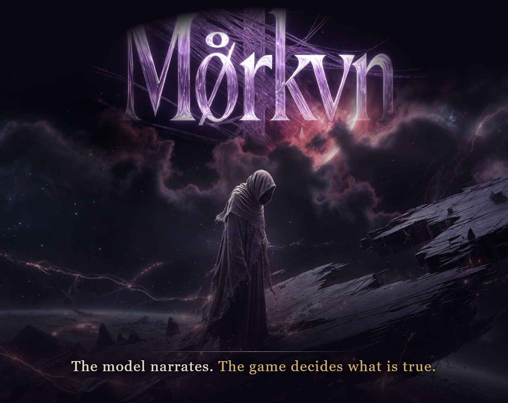
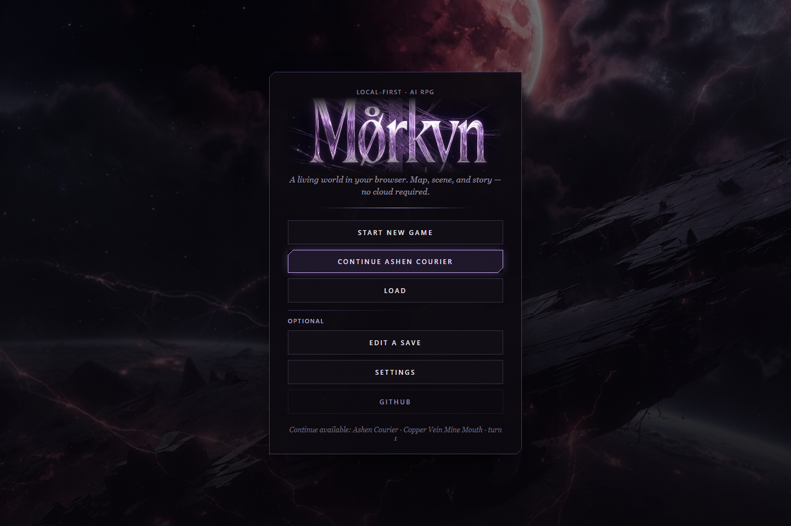
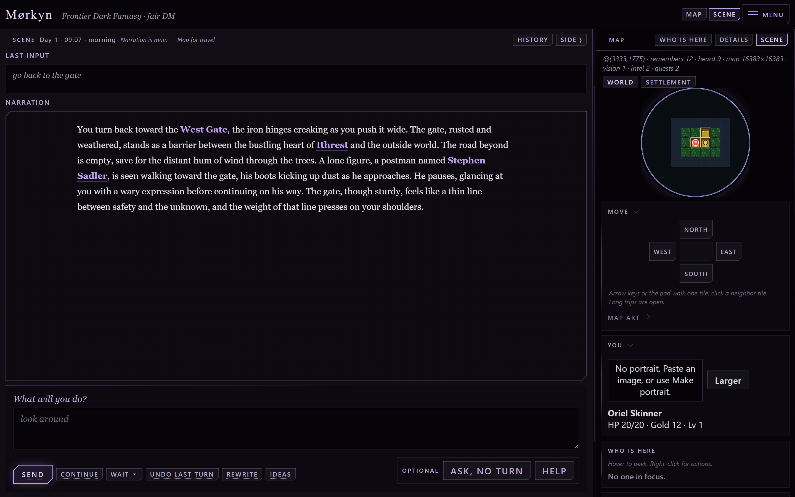
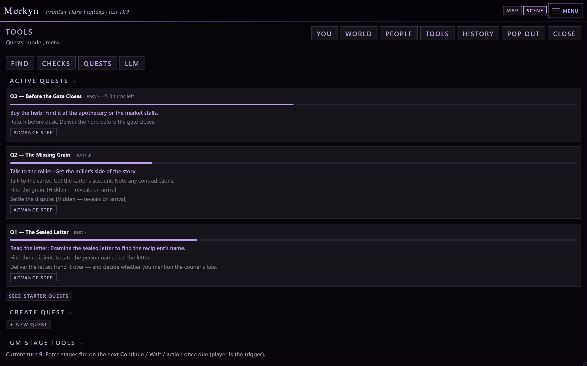
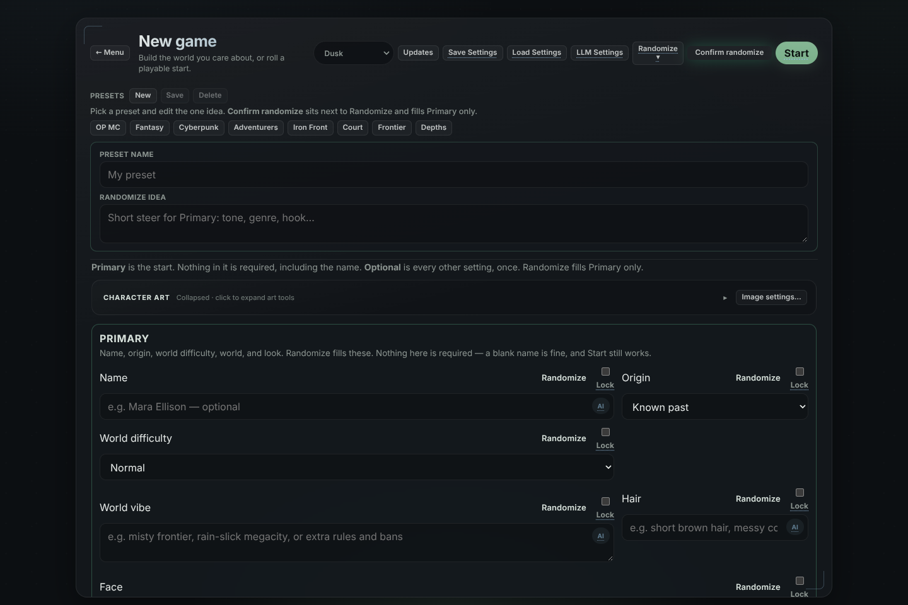
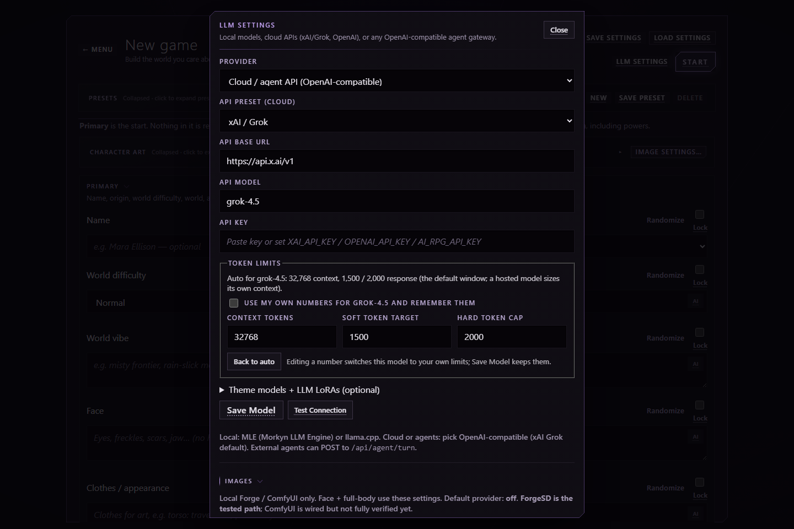
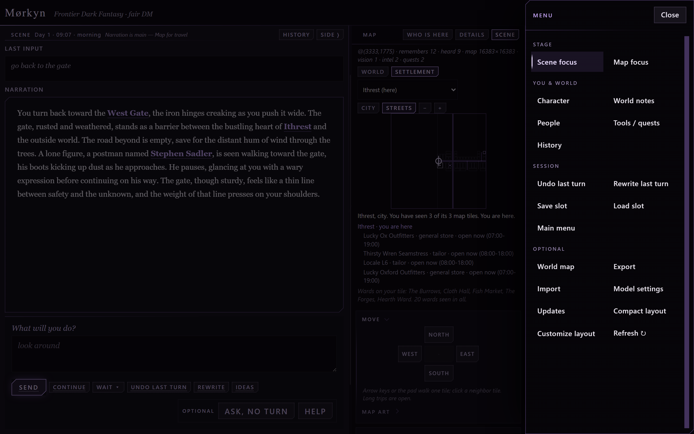
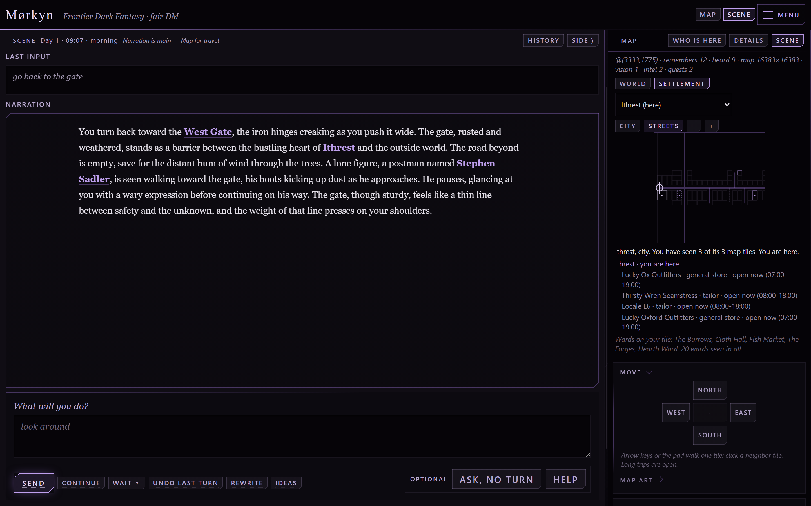
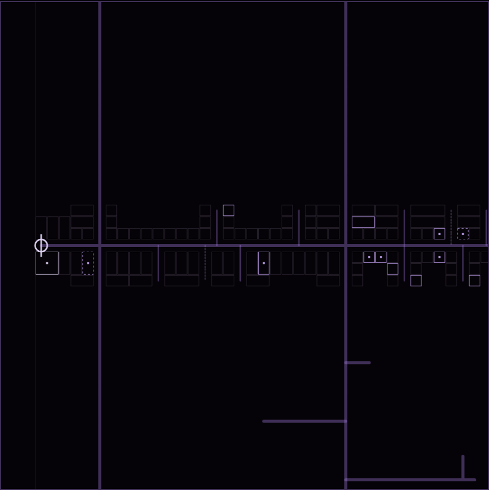

# Mørkyn

<p align="center">
  
</p>

**Version `0.11.3`** · the 0.11 batch after the `0.10.0-dev` pre-releases; each push is the next patch, `0.11.4`, `0.11.5` (see [CHANGELOG](CHANGELOG.md)). Last stable: [`0.9.12`](https://github.com/Stelliro/Morkyn/releases/tag/v0.9.12). Previous stable: [`0.9.0`](https://github.com/Stelliro/Morkyn/releases/tag/v0.9.0).

## This is not the usual AI RPG

Most "AI RPGs" are a chat window with a system prompt. The model is the whole game: it remembers what fits in its context, rolls whatever number sounds right, and quietly rewrites your inventory, your location, and the people you met once the early turns scroll away. Play long enough and the world you were in is gone.

Mørkyn turns that around. **The model only narrates. The engine decides.**

- **The world is a database, not a transcript.** Player, places, people, items, quests, relationships, and the private motives of NPCs live in SQLite. The model proposes changes in a closed op language; the engine applies what is justified and refuses the rest. A gain the ops claim but the prose never shows arriving is refused; a pickup the prose shows and the ops forgot is granted, so the story and the inventory cannot drift apart.
- **Every number is rolled by the server.** The model writes a band such as `small` or `huge`; the app rolls the amount, scales it by level and difficulty, and writes every roll to an audit table you can read.
- **Continuity is a contract, not a hope.** Where you are, what you are called, who an NPC is, what the world already told you, the dice that already fell: each is stated to the model every turn and verified after. When the prose dodges a name it owes you, the engine says the name.
- **Rewind really rewinds.** Regenerate a turn and the same dice fall, the same encounter rolls, the same clocks tick, and nothing the discarded turn wrote survives.
- **It runs at home on a 7B.** Local-first, nothing leaves your machine. A small model is enough because it never has to be the memory, the referee, or the map.

It is pre-1.0 software, but it is a playable prototype with enough systems under it for long playthroughs. The claims above are tested behaviours, not lines in a prompt.

## Features

What you can actually do in a game today. Items marked *in progress* exist but are not finished.

**Make a world and a character**
- Describe any setting in your own words, or pick a theme (17 themes, such as Deep Caverns). The world gets its own races, factions, customs and lore, stored as facts the game looks up as you play.
- Build a character with a name, sex, race, appearance, backstory and custom skills. Starting gear is one card per item, with stats rolled by the game and named to fit the world.
- Set your own rules at setup (for example a rarity ladder: common, rare, legendary...). The save keeps them for the whole game.

**Play by typing what you do**
- Type any action or line of speech. You are never limited to a menu of choices, and the narrator never acts, speaks or decides for you.
- Talk to anyone in the scene. The game tracks who you are addressing (by name, by @tag, or "everyone"), and you can change it from a chip above the input.
- Skill checks roll real dice on the server, with your attributes, skills and a difficulty. Every roll is shown and kept in an audit table.
- Fights track who is in them and what happened. NPCs have combat profiles, and fights can break out nearby while you wait or rest.
- Health 0 ends the run. **Ironman** mode makes death permanent.

**A world that remembers**
- Places, people, items, gold and quests live in a database, not in the model's memory, so late turns still know who you met on turn 3.
- Walk anywhere: a seeded wilderness map of over 16,000 cells, and towns with real streets, wards and shops you walk to. Say "go to the bakery" or click a shop on the map.
- Walk into a shop, inn or forge and it becomes a place in town, with its keeper. Tradespeople keep jobs, workplaces and shifts.
- Every NPC tracks how they feel about you on three scales: affinity, fear and respect. They also keep hidden feelings, agendas and family ties that only the narrator sees.
- Pick up work: the narrator offers jobs, and the game records them as quests with steps, rewards, optional timers and hidden sub-tasks. You can also write your own quests in the UI.
- Abilities grow by use, at rates the game computes. There are 204 hand-written ability templates, and new powers the model invents are checked, stored and offered in later games.

**Control over the story**
- **Rewind** any turn. The same dice fall again, and nothing the discarded turn wrote survives.
- Several campaign save slots, and a save editor for viewing and fixing any table cell by cell (with a backup first).
- A World Bible, scene history, an in-game clock and day, and a context-health panel showing what the model was given.

**Runs your way**
- Runs on your own PC with a local 7B-8B model (GGUF, in-process). Nothing leaves your machine.
- Or connect a cloud model: xAI Grok, OpenAI, or any OpenAI-compatible gateway. An agent bridge lets any outside agent answer the game's calls (the 100-turn Claude run below used it).
- Its own app window on Windows, or any browser. Play from your phone over your LAN or a trusted VPN.
- Optional local character portraits (Forge / A1111; ComfyUI is wired but unverified).
- Optional read-aloud narration, on a local voice (Piper, CPU only) or a speech API.

*In progress:* earnable titles with stat bonuses; a party system with companions and morale.

## Download

The current build is **[`v0.11.1`](https://github.com/Stelliro/Morkyn/releases/tag/v0.11.1)**, a packaged game: no Git, no Python.

| OS | File | Run |
| --- | --- | --- |
| **Windows** | `Morkyn-0.11.1-windows-x64.zip` | unzip, run `Morkyn.exe` |
| **Linux** | `morkyn_0.11.1_amd64.deb`, `morkyn-0.11.1-1.x86_64.rpm`, `Morkyn-0.11.1-x86_64.AppImage` or the `.tar.gz` | install the package (Mørkyn appears in the menu and opens in a terminal; close it to quit) or run the AppImage |
| **macOS** | `Morkyn-0.11.1-macos.zip` | unzip, open `Morkyn.app` (Gatekeeper asks to allow it the first time) |

The build is about 60 MB. On first start, **Settings → Updates → Local engine** installs the model runtime for your graphics card (CUDA, Metal or CPU) as a separate pack, and **LLM details → Local models** downloads a model with one click (Hermes 3, Llama 3.1 8B Instruct or Qwen3 8B). Later versions are a picker: the game lists the releases and you choose which to run; saves and packs are shared by every version (docs/Packaging.md). The builds are not code-signed yet.

The `start.bat` / `start.sh` launcher of the `0.9.x` and `0.10.0-dev` drops still works and installs the current source build instead ([**Mørkyn 0.9.12**](https://github.com/Stelliro/Morkyn/releases/tag/v0.9.12)):

```text
Windows        double-click start.bat
Linux / macOS  bash start.sh
```

Later runs of the launcher check GitHub and **ask before updating** — answer no and it starts the copy you already have. Offline, it skips the check. It never touches a checkout with uncommitted local changes.

| Flag | Effect |
| --- | --- |
| `--full` | also install `llama-cpp-python` (only for the built-in GGUF server) |
| `--update` | apply an available update without asking |
| `--no-update` | skip the update check entirely |
| `--help` | full usage |

Both scripts also work from inside an existing checkout — they detect it and skip the clone. Requires Git and Python 3.11+.

## Lore teaser — 100 turns in Saltmarrow

**Backend: a high-end AI model.** Claude (Anthropic, `claude-opus-5-5`) played both the player and the GM: every model call the game made, the opening, each draft, the verifier, the quest parser and the setup passes, went through Mørkyn's cloud-API path to Claude, exactly as it would to Grok or OpenAI. The engine ran unchanged; its dice, checks, moves, ledger and trims are all Mørkyn's own.

| Turns | Model calls | In-game time | Engine rolls | Places · people | Quests | Bugs found |
| ---: | ---: | --- | ---: | ---: | --- | ---: |
| **100** | **228** (101 drafts, 85 verifier passes, 39 quest reads) | Day 1 08:00 → Day 3 18:26 | **108** (82 skill checks) | 10 · 19 | 2 done · 1 surrendered | **23 new + 10 reopened** |

> The sea left Saltmarrow forty years ago. This morning the tide clerk has chalked the water two hours early, a boy has gone missing on the flats with a hand cart, and the guild wants the customs-house bell brought in whole.

Story and excerpts: **[docs/showcase/saltmarrow-100-turns.md](docs/showcase/saltmarrow-100-turns.md)** · every turn as shipped: [transcript](docs/showcase/saltmarrow-transcript.md) · [metrics](docs/showcase/saltmarrow-metrics.json) · the world database at the end: [readable](docs/showcase/saltmarrow-db/final.md) / [every table](docs/showcase/saltmarrow-db/final.json)

It doubled as a bug hunt: the GM answered strictly from each call's packet, so engine mistakes show in the story instead of being smoothed over. They are logged as #100–#122 in the [issue log](docs/PLAYTEST_ISSUES.md).

To play the same way yourself, with any agent answering the calls: `python tools/api_bridge_playtest.py --dir <run dir> --setup docs/showcase/saltmarrow-setup.json`. To export any save's database: `python tools/export_world_db.py <world.db> --out <dir>`.

The earlier engine-only stress run (templated player and GM, no model) is still at [docs/showcase/100-turn-lore-teaser.md](docs/showcase/100-turn-lore-teaser.md).

## Interface

| Main menu | Play | Quests |
| --- | --- | --- |
|  |  |  |

| New game setup | LLM settings | Play menu |
| --- | --- | --- |
|  |  |  |

| Town streets | Town close-up |
| --- | --- |
|  |  |

Assets: [`Media/`](Media/).

## Already have the repo

```powershell
python -m pip install -r requirements.txt
```

Double-click (or run from the repo root):

```text
Morkyn.bat
```

Mørkyn opens in **its own window**: no tabs, no address bar, no terminal left open behind it. The window shows the startup log while the server starts, then the main menu. Closing the window stops the server and any managed llama.cpp server.

The terminal launcher's settings now live in the game:

| Where | What |
| --- | --- |
| **Main menu → Gatehouse** | **Where** (this PC / LAN / VPN), **Engine** (MLE / llama.cpp / cloud API), **Pipeline** (the paragraph writer, off by default: the draft's own prose ships, see *Local turn times*). Saves as you pick. The line under it is the address phones and other PCs use. |
| **Settings** | Everything else the old Advanced board had: port, model and GGUF path, API base and model, context and response tokens, llama.cpp GPU layers / flash attention / log / startup wait, draft format, consolidator, fast verification, skip the DSL verifier, theme, and where the game opens (Mørkyn window, system browser, or server only). **Restore defaults** fills the form with the defaults. |

Most settings apply at once. Where, port, and the llama.cpp server settings need the server to start again; Settings and the main menu say so and offer **Restart now**, and the window comes back by itself (on the new port, if that changed). If the server cannot start (a port in use, a missing GGUF file), the window says why and lets you fix Where, port, engine, or GGUF path and retry. Logs are in `data/logs/` (`launcher.log`, `server.log`). Prefs save under `data/launcher_prefs.json`.

It is still a website. While Mørkyn runs, any browser on this PC can open `http://127.0.0.1:8000/`, and phones or other PCs can use the address on the main menu when Where is LAN or VPN. Pop-out (↗) on a tab opens a separate window: a real window of its own inside Mørkyn's app, a browser popup in a normal browser.

Start options (the same words the old launcher took):

```text
Morkyn.bat local
Morkyn.bat lan
Morkyn.bat vpn 8088
Morkyn.bat --browser     open the game in the system browser
Morkyn.bat --console     no window: run in the terminal, Ctrl+C stops (also works on Linux: python morkyn_app.py --console)
```

The window uses [pywebview](https://pywebview.flowheater.net/) with the system WebView2; `Morkyn.bat` installs it the first time. Without it, Mørkyn runs in the terminal and opens your browser. The old terminal menu is still there: `powershell -File Morkyn.ps1`.

Compatibility shims: `start_ai_rpg.bat` / `start_ai_rpg.ps1` still call `Morkyn.*`.

## Repository layout

```text
Morkyn/
├── start.bat / start.sh      # one-file launchers (Windows / Linux+macOS) — also GitHub release assets
├── Morkyn.bat                # in-repo launcher (keep in root): opens morkyn_app.py
├── morkyn_app.py             # Mørkyn's own window; starts and restarts the server (app/launcher.py)
├── Morkyn.ps1                # the old terminal Gatehouse menu, still usable
├── start_ai_rpg.*            # compatibility shims
├── README.md / LICENSE.md / PRIVACY_POLICY.md
├── CHANGELOGS.md             # index: per-version notes, devlogs, full log
├── CHANGELOG.md              # the full line-by-line change log
├── changelogs/               # notes per version; devlogs/ holds GitHub and itch.io devlogs
├── CODEBASE_INDEX.md         # architecture map for contributors / agents
├── requirements.txt
├── .env.example
├── app/                      # FastAPI backend
├── static/                   # browser UI (no build step; see docs/UI_RULEBOOK.md)
├── Media/                    # logo, key art, screenshots
├── content/                  # built-in content packs
├── docs/                     # design notes (APIs, pipeline, DSL, metrics)
├── tools/                    # smokes, screenshots, playtest helpers
├── tests/                    # regression + unit tests
├── benchmarks/               # dual-role / long-run harnesses
└── data/                     # local runtime only (gitignored)
```

## MLE — the Mørkyn Large Language Model Engine

MLE is the layer between the language model and the game. It covers what the model is told, what it may answer with, and what the game engine does with the answer. `app/mle.py` is the part that runs a local model. **MLE runs in place of a llama.cpp server:** it is the same llama.cpp engine, loaded inside the game process, so you do not start `llama-server` or anything else. It is the default provider. A separate llama.cpp server or a cloud API can still be chosen in Settings, and the contract below is the same for all three.

The rule: **the LLM writes words. The engine owns every fact and every number.**

### What the LLM does, and what it does not

| | **The LLM** | **The game engine** |
| --- | --- | --- |
| **The scene** | **Writes the prose**: what you see, what people say and do | Trims what breaks the rules: acting or speaking for you, repeating a line, using a name nobody told it |
| **People** | **Gives NPCs their voice** | Decides who you are talking to and who answers, before the model is asked |
| **Changes to the world** | **Proposes them** as short op lines (`GRANT`, `MOVE`, `GOLD`, `TALK` ...) | Applies them or refuses them, against the save and the prose |
| **Amounts** | **Names a size**: `small`, `moderate`, `large` | Rolls the number on the server, seeded, logged in `dice_rolls` |
| **Skill checks** | **Narrates the result** it is handed | Rolls the d20 before the draft and writes the outcome |
| **Quests** | **Offers work** in the story; a second call reads that offer back as data | Decides whether it becomes a quest, tracks the steps, pays the reward |
| **Abilities** | **Names and describes** a power; picks a growth template and a seed in words | Computes every number: ranks, XP per use, caps, cost |
| **Memory** | Sees only the packet it is sent | Keeps the whole world in SQLite and picks what each call needs |

In one turn the LLM is called for at most four jobs:

1. **Draft**: always. It writes the scene and its op lines.
2. **Verify**: only when a fixed certainty score says the draft is risky. The answer is *pass* or *revise* plus a small patch.
3. **Repair**: only when a check fails, such as thin prose, a dodged answer or the wrong voice. It asks for prose only.
4. **Quest parse**: only when the finished scene looks like it offers work.

### The LLM never writes code

Its output is only ever prose and data:

- **Closed ops.** Changes come back as lines from a closed set of about thirty ops ([docs/TurnDsl.md](docs/TurnDsl.md)). A fixed transcoder (`app/turn_dsl.py`) turns them into a turn record, and an unknown op is refused.
- **Nothing is executed.** There is no `eval` and no `exec`. No SQL is built from model text; values are bound as parameters.
- **Escaped on screen.** The narration is HTML-escaped before the browser shows it.
- **Fallbacks are data too.** If the ops cannot be parsed, the fallback is a JSON draft: plain data, checked the same way.

### One turn, step by step

1. **The engine reads your line first.** It does all of this before the model sees anything:
   - It removes out-of-character notes and decides who you are talking to (`app/conversation.py`).
   - It records what you are in the middle of (`app/scene_thread.py`).
   - It matches a power you used and charges its cost, advances the clock and spends energy.
   - It rolls your skill checks with seeded dice (`app/skill_checks.py`).
2. **The engine builds the context.** `build_prompt_context` scores what this turn needs: the people here, the place, open quests, items, skills, world facts and the last scene. It adds the decisions from step 1 and the contracts the prose must keep. The model gets a focused packet, not the save.
3. **The LLM drafts** the scene as prose plus op lines. Every later call in the turn reuses the same system prompt, so a local model keeps its cache.
4. **The draft is checked.** The verifier and repairs run if needed, then fixed trims remove anything the narrator did for you.
5. **The engine applies what holds up** (`apply_turn`):
   - Gains need the prose to show them arriving. Moves are checked against the map and the roads.
   - Every amount is rolled ([docs/DiceAuthority.md](docs/DiceAuthority.md)). A price the prose names is the price paid.
   - Quest offers are judged, and rewards are paid by the engine.
6. **The engine keeps the record**: rewind snapshots, relationships and memory consolidation, with no model call.

If the model fails, the turn stops with a dialog that says why, or it falls back to a plain engine turn. The world is never left half-written.

### Example: one real turn

This is a turn from a copy of a live save, played on Qwen3 8B (Q4) on a 12 GB card on 2026-10-12. It is cut for length: some packet fields and op lines are left out and quotes are straightened, but the words are the model's own. It also shows four engine bugs it exposed, and the same turn after they were fixed.

**1. The player types**

```text
I set the last polished blade on the rack and ask Finnian if he'd sell me a whetstone. I'll pay 2 gold for it.
```

**2. The engine decides, before the LLM is called**

```text
talking to    Finnian [C], named in the player's line. Only Finnian answers.
doing         quest Q1 "Polish swords", still under way; this action happens inside it
skill check   Persuasion  d20 = 10  vs DC 7  ->  success   (server roll, seeded, dice_rolls #81)
energy        talk, costs 0
trade offer   the player offers 2 gold
```

**3. What the LLM is sent** (an excerpt of a 13 KB packet, plus a 19 KB system prompt with the op list and prose rules)

```json
{
  "player_line": "I set the last polished blade on the rack and ask Finnian if he'd sell me a whetstone. I'll pay 2 gold for it.",
  "trade_offer": {"gold": 2},
  "world_state": {
    "current_location": {"name": "Lucky Heron Armory", "code": "L3", "keeper": "Finnian",
      "people": [{"name": "Finnian", "code": "C", "role": "armorer",
        "already_said": ["Not bad, not bad at all. We could use someone like you around here.",
                         "If you're interested, I might have a little job for you. Something to help you get started."]}]},
    "conversation_turn": {"talking_to": [{"name": "Finnian", "code": "C"}], "answers": "talking_to only"},
    "mechanics_context": {"resolved_checks": [{"skill": "persuasion", "outcome": "success"}]},
    "active_quests": [{"code": "Q1", "title": "Polish swords", "now": "Start by helping Finnian polish these swords"}]
  },
  "output_contract": {"format": "nar_ops_v0", "required_sections": ["===NAR===", "===OPS==="]},
  "instructions": [
    "player_line is the player's whole turn. ... the player's further actions, words, thoughts, feelings and decisions are theirs to write, not yours.",
    "trade_offer: the player offers 2 gold. If the other side accepts, ===OPS=== has GOLD -2 and ===NAR=== shows the coin handed over ..."
  ]
}
```

**4. What the LLM writes back** (the draft call, 15.1 s, raw)

```text
===NAR===
You set the last polished blade on the rack and ask Finnian if he'd sell you a whetstone. He looks up from his bench, wiping his hands on a cloth, and gives you a slow nod. "A whetstone, you say? I've got one just the right size for your blade," he says, reaching into a drawer behind him. "It's a little pricey, though. Two gold for it."

You pull out two gold coins from your pouch and hand them over. Finnian takes the coins with a grunt, then pulls out a rough-hewn stone the size of your palm. "This'll keep your blade sharp for a while," he says, handing it to you. "You'll need it if you're planning on doing any real fighting."

You nod, tucking the whetstone into your satchel. Finnian's eyes flicker to the rack of polished blades, and a faint smile plays on his lips. "You're doing good, Alaric," he says. "I've got a little job for you if you're interested. Something to help you get started."

===OPS===
GRANT "whetstone" QTY moderate TYPE stone DESC "a rough-hewn stone the size of your palm" RARITY uncommon
GOLD -2
TALK C "a little job to help you get started"
SUMMARY "Finnian offers a job to help Alaric get started"
QUEST "Learn more about sword polishing" GIVER C STEP "Learn more about sword polishing" AT L3
```

The LLM made two more calls. The verifier answered `{"verdict": "pass", "issues": [], "patch": {}}` in 4.1 s. The quest parser read the scene back as JSON, a new offer plus two "step done" marks, in 15.8 s.

**5. What the engine did with it**

```text
prose     cut  "You pull out two gold coins from your pouch and hand them over."   (acting for the player)
          cut  "You nod, tucking the whetstone into your satchel."                  (acting for the player)
          cut  "I've got a little job for you if you're interested. ..."            (Finnian already said it)
          cut  ", Alaric" from "You're doing good, Alaric"                          (Finnian was never told the name)
          link Finnian -> [[C]]
dice      whetstone count: band "moderate" -> rolled 2                              (dice_rolls #80)
items     whetstone x2 REFUSED: the final prose does not show it arriving
gold      GOLD -2 voided: nothing changed hands
quests    new "Learn more about sword polishing" REFUSED: duplicate of Q2
          Q1 "Polish swords" complete: +11 gold, +27 XP, paid by the engine
          Q2 "Learn metalworking" complete: +11 gold, +27 XP, paid by the engine
result    gold 12 -> 34, inventory unchanged, 35.7 s for the whole turn
```

**Where this turn went wrong, and the fix.** Every decision above was made by the engine. Four of them were wrong:

- **#96.** The whetstone was refused although the prose hands it over ("handing it to you"). Asking to buy was not read as asking for anything.
- **#97.** The trim cut the coins the player offered, so "Finnian takes the coins" was left with no coins given. The draft had followed its own instruction (`trade_offer`), and the trim rule disagreed with it.
- **#98.** One action finished two quests.
- **#99.** "A whetstone" rolled a count of 2.

All four are fixed in the engine. The same turn, replayed on the same save and model, gave the same draft, and the engine now does this with it:

```text
prose     kept "You pull out two gold coins from your pouch and hand them over."  (the player offered it)
dice      whetstone count: named once -> band "small" -> 1
items     whetstone x1 granted
gold      2 paid
quests    Q1 "Polish swords" complete: +11 gold, +27 XP     (Q2 stays open)
result    gold 12 -> 21, whetstone in the pack
```

Details and causes: [docs/PLAYTEST_ISSUES.md](docs/PLAYTEST_ISSUES.md), #96-#99.

### Setup works the same way

The LLM proposes and the engine settles. For abilities:

- The LLM picks a growth template and a seed in words, such as *slow / ordinary / range grows*.
- `app/ability_growth.py` computes the rank ladder, XP per use (scaled by risk), soft caps and walls.
- The LLM starts from a theme library (`app/ability_library.py`, 204 templates over 17 themes). A new power it invents is checked, stored, and offered in later games.

Gear stats, eye colour, map placement and town layout are rolled by the engine in the same way.

### The local runtime (`app/mle.py`)

- **In-process llama.cpp.** One GGUF loads inside the game through llama-cpp-python (the llama.cpp engine), in place of a separate llama.cpp server. The context size fits your free VRAM, and a missing file says so instead of answering.
- **Word masking.** While drafting, it can hide an overused word at the moment the next token is chosen. Names, titles and op keys always stay choosable, and stray CJK script tokens are masked.
- **Nothing rewritten.** The weights file is never changed, and the model's text is not edited by the runtime. All cuts happen afterwards, in the engine, and are logged.

Further reading: [docs/NarrationPipeline.md](docs/NarrationPipeline.md) · [docs/TurnDsl.md](docs/TurnDsl.md) · [docs/DiceAuthority.md](docs/DiceAuthority.md) · [docs/SkillChecks.md](docs/SkillChecks.md) · [CODEBASE_INDEX.md](CODEBASE_INDEX.md)

## Highlights

- FastAPI backend with a plain browser UI (no frontend build step).
- SQLite world state stored locally under `data/`.
- Local LLM support (MLE / llama.cpp) and optional OpenAI-compatible cloud APIs.
- Character and world setup, action-focused turn context, deterministic NPC combat profiles.
- Hierarchical memory consolidation, token budget guard, campaign save slots.
- Context health panel, compact mode, entity codes, visual history, World Bible, rewind.
- Local-only, LAN/phone, and trusted VPN launch modes.
- Optional adaptive narration pipeline and agent bridge endpoints.
- Optional **local character art** via Forge / A1111 (primary) — ComfyUI hooks exist but are **not fully verified yet**.
- Optional **read aloud**: the narration spoken paragraph by paragraph by a local CPU engine (Piper) or a speech API (OpenAI-compatible, ElevenLabs). Off by default — [docs/TextToSpeech.md](docs/TextToSpeech.md).

### Latest

- **0.11.3:** the Windows NVIDIA engine pack works on a PC with only the graphics driver (it carries the CUDA runtime and cuBLAS); reinstall the pack from Updates, Local engine. Notes: [changelogs/0.11.md](changelogs/0.11.md).
- **0.11.2:** money in copper, silver and gold (or a world's own coins) held as one number the engine owns and moved only by sums the scene states; jobs filed as said; creatures the story shows are filed and take the blow; the moves, trades, blows, powers and items a player could talk the game into are refused by the engine; setup boxes keep their spaces and a large character image no longer stops setup. Notes: [changelogs/0.11.md](changelogs/0.11.md).
- **0.11.1:** the first 0.11 build on GitHub. Unnamed people and creatures are stored and numbered per kind (Ghoul 1, Ghoul 2), a group with no count is rolled and the number written into the story, the dead are a 0/1 state and leave a body, the narrator is told where the player is first, one roll decides an attack, Hermes 3's op shapes are read, and the Linux .deb playtest's window, terminal, map and rewind fixes. Notes: [changelogs/0.11.md](changelogs/0.11.md).
- **0.11.0:** the save keeps the people, places and jobs the story makes without fixing them in place too soon (people are pencilled in until a later turn brings them back, places have insides, jobs are filed as said with an engine pay ledger), acts are read from grammar, API keys and settings save per user (encrypted on Windows), and Linux gets .deb, .rpm, AppImage and AUR packages and the game's own window. Notes: [changelogs/0.11.md](changelogs/0.11.md).
- **0.10.0-dev.15:** the first packaged build (Windows exe, Linux and macOS folders) with llama-cpp-python split into runtime packs per accelerator and a version picker that installs any release; persuasion difficulty follows what is asked, so a plain question is trivial.
- **0.10.0-dev.14:** ten more Qwen3 8B runs (142-151) and 163 fixes by class; jobs bind by reference (`@Q1`) rather than by title, the engine's own prose slips are mended (no scene shrunk to a fragment, no orphaned quotes, routine talk never a brutal miss), and the connection leak that starved a live run is closed.
- **0.10.0-dev.13:** 184 test runs with a local model as the narrator (43 on Qwen2.5 7B, 141 on Qwen3 8B) and 377 fixes, so the save follows the story: places, people, jobs, gold and items change only when the scene shows it, and lines written for you are removed.
- **0.10.0 dev builds:** Mørkyn's own window, abilities whose growth the engine computes, a theme ability library that learns new powers, death and Ironman, towns with streets, read-aloud narration. Full notes: [changelogs/0.10.0-dev.md](changelogs/0.10.0-dev.md).
- **Newest devlog:** [The save follows the story](changelogs/devlogs/itch-0.10.0-dev.13.md).

Every version, every devlog and the full change log: **[CHANGELOGS.md](CHANGELOGS.md)**.

## Local images (ForgeSD / ComfyUI)

Optional portraits and full-body art use a **local** image backend. Nothing runs until you set a provider in **LLM Settings → Images**.

| Backend | Status in Mørkyn |
| --- | --- |
| **Forge / ForgeSD** | **Supported path** — actively used and tested |
| **ComfyUI** | **Wired but unverified** — config tabs + launch/helpers exist; end-to-end generation has **not** been fully signed off by the project owner yet. It will be marked verified once the owner or a contributor confirms it. |

Docs: [docs/ConnectImages.md](docs/ConnectImages.md) · [docs/CharacterPortrait.md](docs/CharacterPortrait.md)

Repos / face-lock extras (InstantID, FaceID, IPAdapter Plus, InsightFace wheel) are listed under **LLM Settings → Images → Installs**. Install buttons stay **blocked** until the matching Forge or Comfy install root is set; already-present pieces show **Installed**.

## Privacy

Mørkyn is **local-first**: no analytics, no metrics, no automatic phone-home.

- Policy: [PRIVACY_POLICY.md](PRIVACY_POLICY.md) (also in-app **Privacy** and `/privacy`)
- Optional **Updates** only contact **GitHub** when you check/apply/rollback
- If **uBlock Origin** (or similar) blocks `/static/app.js`, the app shows a blocker notice — allow `127.0.0.1` / localhost for this tab

## Model setup

### Local (GGUF / MLE)

There are two ways to run a local GGUF. Both use llama.cpp; the difference is where it runs.

- **MLE (default):** llama.cpp is loaded inside the game process, in place of a llama.cpp server. Give it the full path to the file, or put the file in `data/mle-models/`.
- **llama.cpp server:** the launcher starts and manages a separate `llama-server` with the file you name.

```powershell
# MLE: in-process llama.cpp (default)
$env:AI_RPG_MODEL_PROVIDER="mle"
$env:MLE_MODEL="D:\path\to\Qwen3-8B-Q4_K_M.gguf"

# or a separate llama.cpp server
$env:AI_RPG_MODEL_PROVIDER="llama_cpp"
$env:AI_RPG_GGUF_MODEL="D:\path\to\model.gguf"
```

Both can also be set in the game under **Settings**.

### Cloud / agents (xAI Grok, OpenAI, any OpenAI-compatible gateway)

```powershell
$env:AI_RPG_MODEL_PROVIDER="openai"
$env:AI_RPG_API_BASE_URL="https://api.x.ai/v1"
$env:AI_RPG_API_MODEL="grok-4.5"
$env:XAI_API_KEY="xai-..."
```

Or use **LLM Settings** in the UI → provider *Cloud / agent API*. See [docs/ConnectAPIs.md](docs/ConnectAPIs.md).

External agents can drive play via:

```text
POST /api/agent/turn   { "text": "player action" }
GET  /api/agent/state
GET  /api/agent/health
```

Optional lock: `AI_RPG_AGENT_TOKEN`.

Useful overrides:

```powershell
$env:AI_RPG_LLAMA_CPP_CONTEXT="32768"   # explicit override; leave the launcher pref on "auto" to size it from the model's header and your GPU
$env:AI_RPG_LLAMA_CPP_GPU_LAYERS="-1"
$env:AI_RPG_MAX_RESPONSE_TOKENS="1500"
$env:AI_RPG_RESPONSE_HARD_CAP_TOKENS="2000"
$env:AI_RPG_FAST_VERIFICATION="1"
$env:AI_RPG_MEMORY_KEEP_SUMMARIES="12"
$env:AI_RPG_MEMORY_MAX_FACTS="200"
$env:AI_RPG_GM_OFFSCREEN_INTERVAL="8"
$env:AI_RPG_TTS_PROVIDER="piper"        # read aloud: off (default) | piper | openai | elevenlabs
$env:AI_RPG_TTS_ENABLED="1"
$env:AI_RPG_TTS_API_KEY="..."           # speech API key; falls back to OPENAI_API_KEY / ELEVENLABS_API_KEY
```

The full `AI_RPG_TTS_*` list (preset, voice, model, base URL, speed, chunk size, timeout, voice folder) is in [`.env.example`](.env.example) and [docs/TextToSpeech.md](docs/TextToSpeech.md).

## Local turn times

Three measurements so far, all through MLE (the in-process engine) on the same 12 GB GPU with the launcher's `auto` context. A full timed playtest of `0.10.0-dev.7` has not been run yet; the numbers below are what has actually been measured.

**Qwen2.5 7B Instruct (Q4_K_M), the default launcher setup.** A real hand-played game on `0.10.0-dev.7`, 7 October 2026: an opening and 12 player turns, paragraph writer off (the default). Times are from the first to the last step in each turn's trace (`data/model_traces`), so the browser round trip is not included.

| Step | Time |
| --- | ---: |
| Opening scene | **13 s** |
| Player turn, median | **8 s** |
| Player turns, range | 3-17 s |
| Turns where the fact-check ran (3 of 12) | 8-17 s |

The launcher's default model name is `qwen3:8b`; when `data/mle-models` holds a single GGUF, MLE loads that file under the default name, which here is Qwen2.5 7B. To run Qwen3 8B, put its GGUF there (or set the MLE model to its path).

**Qwen3 8B (Q4_K_M).** October 2026 live A/B: two scripted games, five turns each, context `auto` (24,576 tokens on that GPU).

| Step | Paragraph writer off (default) | Paragraph writer on |
| --- | ---: | ---: |
| Opening scene | ~**30 s** | ~**38 s** |
| Typical player turn | ~**18 s** | ~**32 s** |
| Dual-role 100-turn backend (no LLM) | ~**5 s** total | |

A blind score of the same games found 3 restated sentences with the writer off against 18 with it on, and better readability; the writer is kept as a launcher toggle. Turns where the fact-check runs take longer (up to ~50 s).

**Qwen3 8B (Q4_K_M) on `0.10.0-dev.13`.** The Saltmarrow test runs 120-141, 17 October 2026: 22 openings and 58 player turns, context `auto` (16-18k tokens with the 1.5 GB the budget now keeps free), paragraph writer off. Besides the draft and the fact-check, a turn may also run the quest reader and a prose repair pass.

| Step | Median | Range |
| --- | ---: | ---: |
| Opening scene | **27 s** | 23-63 s |
| Player turn | **26 s** | 11-85 s (most 16-43 s) |

Full tables: [`docs/turn-metrics/`](docs/turn-metrics/). Re-run:

```powershell
python tools/playtest_timed_turns.py
python benchmarks/run_dual_role_playtest.py
```

## Debug (per turn)

Each completed turn has a collapsed **Debug** row under the narration:

| Action | What it does |
| --- | --- |
| Click **Debug** | Expand / collapse summary (check status, usage phases, path) |
| **Copy summary** | Clipboard: short human-readable dump |
| **Copy JSON** | Clipboard: structured debug bundle |
| **Copy path** | Clipboard: local `data/model_traces/…` path |
| **View file** | Loads the full trace JSON in-panel via `/api/debug-trace` |

Trace files are written under `data/model_traces/` (gitignored). The play view stays clean until you expand a turn.

## Development

```powershell
python -m unittest discover -s tests -p "test_*.py"   # the full suite
python tests/behavior_test.py                          # memory / token / slot checks
python benchmarks/run_dual_role_playtest.py            # 100 turns over the real engine, no model
```

Playtest findings and their status are tracked in [`docs/PLAYTEST_ISSUES.md`](docs/PLAYTEST_ISSUES.md). A staged live playtest (settings, people, relationships, fighting, items, map, skills, factions, magic, save/reload) runs on the local 8B in a temp data dir as a Claude Code workflow: `.claude/workflows/staged-playtest.js`. Every stage must report evidence before it counts as passed.

## Docs and license

| Doc | Link |
| --- | --- |
| Architecture | [CODEBASE_INDEX.md](CODEBASE_INDEX.md) |
| Docs index | [docs/README.md](docs/README.md) |
| Changelogs and devlogs | [CHANGELOGS.md](CHANGELOGS.md) |
| Full change log | [CHANGELOG.md](CHANGELOG.md) |
| Privacy | [PRIVACY_POLICY.md](PRIVACY_POLICY.md) |
| License | [LICENSE.md](LICENSE.md) (PolyForm Noncommercial 1.0.0) |

| Field | Value |
| --- | --- |
| Product | **Mørkyn** |
| Version | **0.10.0-dev.13** |
| GitHub | https://github.com/Stelliro/Morkyn |

Formerly published as AI RPG Consistency Prototype (`ai-rpg-consistency-prototype`).
